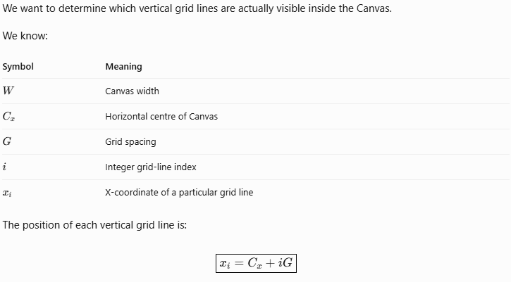
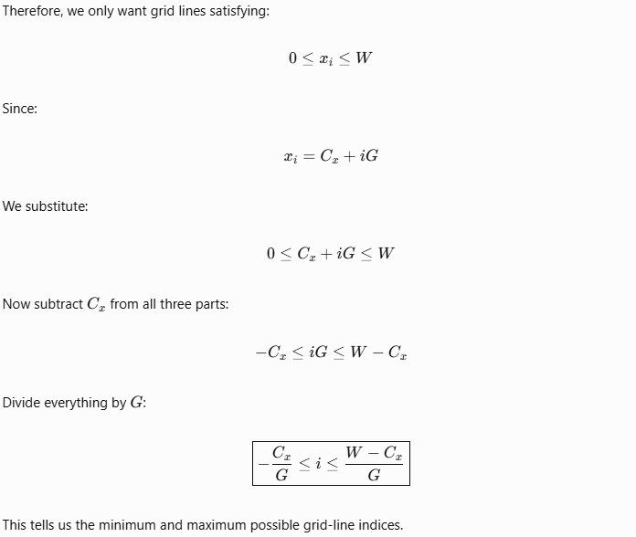
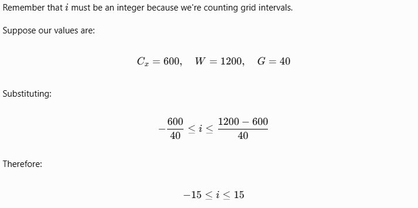
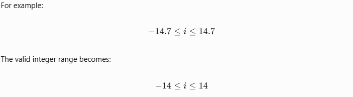
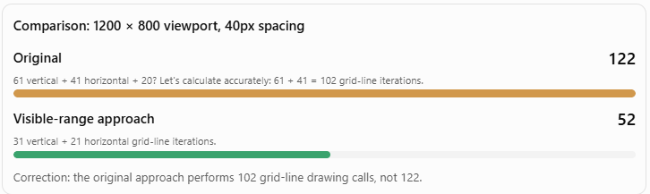

# vekt_flutter

## Grid Rendering Optimization

### Overview

Initially, [this Grid implementation](https://github.com/gaucho96/rect_flutter/blob/6bb32326610bce46d02b3e4b945b4f0fdc2088b1/lib/views/rect_painter.dart#L35-L84) used symmetrical iteration ranges to draw vertical and horizontal grid lines around the center of the Canvas. Although this approach worked correctly, it generated additional drawing operations for grid lines positioned outside the visible viewport. We improved the algorithm by calculating the actual visible grid-line index ranges.

### 1. Initial implementation

```dart
final verticalLineCount =
    (size.width / _gridSpacing).ceil();

final horizontalLineCount =
    (size.height / _gridSpacing).ceil();
```

The drawing loops started at the negative line count and continued to its positive counterpart:

```dart
// Vertical lines
for (var i = -verticalLineCount;
    i <= verticalLineCount;
    i++) {
  final x = centerX + i * _gridSpacing;

  canvas.drawLine(
    Offset(x, 0),
    Offset(x, size.height),
    gridPaint,
  );
}

// Horizontal lines
for (var i = -horizontalLineCount;
    i <= horizontalLineCount;
    i++) {
  final y = centerY + i * _gridSpacing;

  canvas.drawLine(
    Offset(0, y),
    Offset(size.width, y),
    gridPaint,
  );
}
```

**Problem:** The symmetrical iteration ranges could extend beyond the Canvas boundaries, generating unnecessary drawing operations. Flutter would subsequently clip those lines.

### 2. Optimized implementation

Instead of calculating the number of intervals from the entire viewport dimensions, we calculate the minimum and maximum integer indices that produce visible grid lines.

```dart
final minVerticalIndex =
    (-centerX / _gridSpacing).ceil();

final maxVerticalIndex =
    ((size.width - centerX) / _gridSpacing).floor();

final minHorizontalIndex =
    (-centerY / _gridSpacing).ceil();

final maxHorizontalIndex =
    ((size.height - centerY) / _gridSpacing).floor();
```

We then use these bounds in our drawing loops:

```dart
// Vertical lines
for (var i = minVerticalIndex;
    i <= maxVerticalIndex;
    i++) {
  final x = centerX + i * gridSpacing;

  canvas.drawLine(
    Offset(x, 0),
    Offset(x, size.height),
    gridPaint,
  );
}

// Horizontal lines
for (var i = minHorizontalIndex;
    i <= maxHorizontalIndex;
    i++) {
  final y = centerY + i * gridSpacing;

  canvas.drawLine(
    Offset(0, y),
    Offset(size.width, y),
    gridPaint,
  );
}
```

### 3. Mathematical reasoning




Our Dart implementation:

```dart
final minVerticalIndex =
    (-centerX / _gridSpacing).ceil();

final maxVerticalIndex =
    ((size.width - centerX) / _gridSpacing).floor();
```

Since the grid-line index must be an integer:

- `ceil()` determines the minimum valid index.
- `floor()` determines the maximum valid index.



**NOTE:** The same calculation applies to horizontal lines using Canvas height (**_H_**) and vertical center (C<sub>y</sub>).

### 4. Performance comparison

Consider a Canvas measuring 1200 × 800 logical pixels, with a grid spacing of 40 logical pixels.



| Metric | Initial | Optimized |
|---|---:|---:|
| Vertical iterations | 61 | 31 |
| Horizontal iterations | 41 | 21 |
| Total drawing calls | 102 | 52 |

This represents approximately 49% fewer grid-line drawing operations.

**Important:** This is a reduction in drawing operations, not a measured 49% improvement in rendering time or frame rate.

### 5. Takeaway

The main improvement was avoiding unnecessary work.

Rather than generating grid lines across a symmetrical range and relying on Canvas clipping, we calculate the visible index boundaries before drawing.

This illustrates an important rendering principle:

> Calculate what needs to be rendered before issuing drawing commands.

For our current application, the initial implementation remains perfectly adequate. The optimized approach becomes more valuable as viewport dimensions increase or rendering complexity grows.
